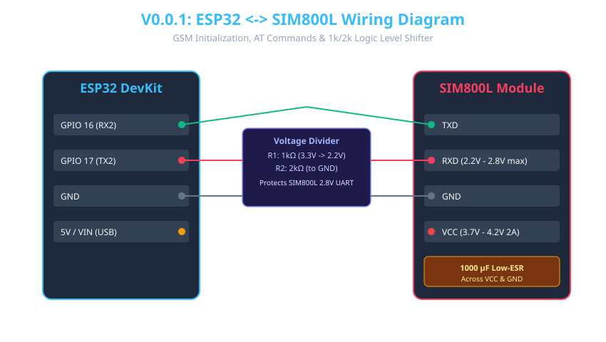

# Version 0.0.1: SMS Basic

## 📌 Purpose
The goal of this version is to establish stable hardware communication between the ESP32 and the SIM800L GSM module. It focuses on initializing the modem, setting it to Text Mode (`AT+CMGF=1`), checking network registration, and sending/receiving basic SMS alerts.

## 🛠 Hardware Setup & Pinout
| ESP32 Pin | SIM800L Pin | Electrical Role / Note |
|-----------|-------------|-------------------------|
| GPIO 16 (RX2) | TXD | UART2 Receive from SIM800L |
| GPIO 17 (TX2) | RXD | UART2 Transmit to SIM800L (**Requires Level Shifter!**) |
| GND | GND | Common Ground Reference |
| 5V / VIN | - | USB 5V or External Supply for ESP32 |
| - | VCC | External 3.7V - 4.2V Power Source (2A Peak Current) |

> ⚠️ **Critical Power Warning:** The SIM800L module consumes up to **2A peak current bursts** during GSM network transmission. Powering it directly from the ESP32's 3.3V or 5V regulator will cause immediate voltage dropouts, leading to continuous ESP32 Brownout Resets (`Brownout detector was triggered`). Always power the SIM800L from a dedicated LiPo battery or high-current DC buck regulator, and place a **1000 µF Low-ESR electrolytic capacitor** directly across the SIM800L VCC and GND pins.

## 🔌 Step-by-Step Wiring Instructions
1. **Common Ground:** Connect the ESP32 **GND** pin to the SIM800L **GND** pin on your breadboard.
2. **UART TX/RX:** 
   - Connect SIM800L **TXD** directly to ESP32 **GPIO 16 (RX2)**.
   - Connect ESP32 **GPIO 17 (TX2)** through a **Resistor Voltage Divider** (1kΩ series resistor connected to SIM800L RXD, with a 2kΩ resistor from SIM800L RXD to GND) to step down the ESP32's 3.3V logic to ~2.2V, protecting the SIM800L's 2.8V UART input.
3. **Power Subsystem:** Connect your 3.7V LiPo battery or 4V regulated power source to SIM800L **VCC**. Connect the 1000 µF capacitor across VCC and GND.
4. **SIM Card:** Insert a standard Nano-SIM card (with deactivated PIN code) into the SIM800L holder.

## 🚀 How to Flash and Test
1. Open the project in VS Code with PlatformIO or Arduino IDE (Board: `DOIT ESP32 DEVKIT V1` or `ESP32-C3 Super Mini`).
2. Open `src/main.cpp` and update your target phone number if testing SMS transmission.
3. Build and flash the firmware to the ESP32.
4. Open the Serial Monitor at **115200 baud**.
5. Observe the boot logs. You should see `AT` responses from the modem (`OK`).
6. Type `s` in the Serial Monitor and press Enter to trigger a test SMS.

---

