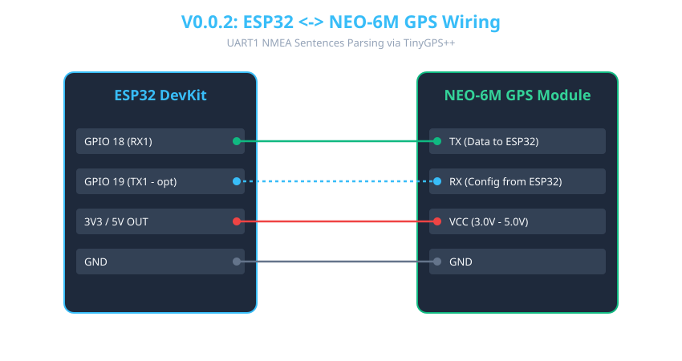

# Version 0.0.2: GPS Serial

## 📌 Purpose
This version focuses on the standalone Global Navigation Satellite System (GNSS) receiver (NEO-6M). It reads raw NMEA 0183 sentences (`$GPGGA`, `$GPRMC`, etc.) from the GPS module over hardware UART and parses them using the `TinyGPS++` library to extract valid latitude, longitude, altitude, UTC time, and satellite counts.

## 🛠 Hardware Setup & Pinout
| ESP32 Pin | NEO-6M GPS Pin | Electrical Role / Note |
|-----------|----------------|-------------------------|
| GPIO 18 (RX1) | TXD | UART1 Receive raw NMEA stream from GPS |
| GPIO 19 (TX1) | RXD | UART1 Transmit configuration (Optional) |
| 3.3V / 5V | VCC | Power Supply (NEO-6M onboard regulator supports 3V-5V) |
| GND | GND | Common Ground Reference |

## 🔌 Step-by-Step Wiring Instructions
1. **Common Ground:** Connect the ESP32 **GND** to the NEO-6M **GND**.
2. **UART Connection:** Connect NEO-6M **TXD** to ESP32 **GPIO 18 (RX1)**. Connect ESP32 **GPIO 19 (TX1)** to NEO-6M **RXD** (optional, used for sending u-blox binary config commands if needed).
3. **Power:** Connect NEO-6M **VCC** to the ESP32's **3.3V** or **5V** output pin.
4. **Antenna Placement:** Attach the external active ceramic patch antenna via the u.FL/IPEX connector and place the tracker near a window or outdoors with a clear view of the sky.

## 🚀 How to Flash and Test
1. Ensure the `TinyGPS++` library is installed in your PlatformIO `platformio.ini` dependencies or Arduino Libraries manager.
2. Build and flash `src/main.cpp` to the ESP32.
3. Open the Serial Monitor at **115200 baud**.
4. **Satellite Fix Notice:** Cold starts outdoors can take 30–120 seconds. Once the onboard PPS/FIX LED begins flashing and NMEA sentences are decoded, Latitude, Longitude, and Satellite count will print continuously.

---

