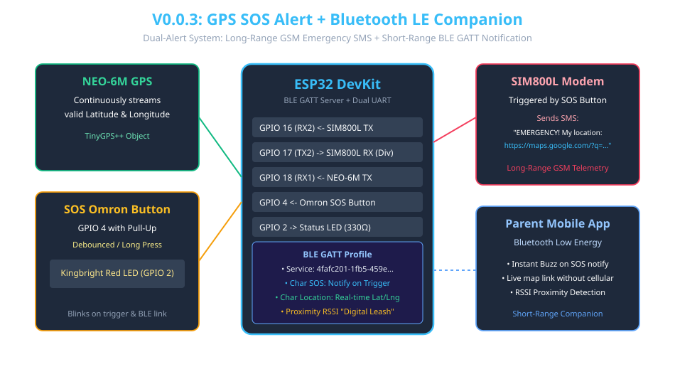

# Version 0.0.3: GPS SMS SOS + Bluetooth LE Companion

## 📌 Purpose
Version 0.0.3 implements the core safety feature of the Kids GPS Tracker: a dual-alert emergency architecture combining **Long-Range GSM Emergency SMS** (with clickable Google Maps coordinates) and a **Short-Range Bluetooth Low Energy (BLE) Companion & Digital Leash** for parents within proximity.

## 🔵 Bluetooth LE Technical Specification & Example
The ESP32 acts as a **BLE GATT Server** advertising a custom Kids Tracker Service. When the child presses the SOS button or when periodic telemetry runs, the ESP32 notifies connected parent smartphones instantly over BLE without incurring cellular SMS costs.

### BLE GATT Profile Structure:
- **Service UUID:** `4fafc201-1fb5-459e-8fcc-c5c9c331914b`
- **SOS Characteristic (Notify / Read):** `beb5483e-36e1-4688-b7f5-ea07361b26a6` (Sends `"SOS_TRIGGERED"` string)
- **Location Characteristic (Read / Notify):** `13333333-3333-3333-3333-333333333333` (Sends JSON: `{"lat":40.7128,"lng":-74.0060}`)
- **Digital Leash / RSSI Proximity:** Parent app monitors RSSI signal strength. If RSSI drops below `-85 dBm` (approx. 10 meters distance), a proximity warning alert is triggered on the parent's phone.

---

## 🛠 Hardware Setup & Pinout
| Component / Module | ESP32 Pin | Electrical Role / Note |
|-------------------|-----------|-------------------------|
| SIM800L GSM TX | GPIO 16 (RX2) | UART2 Receive |
| SIM800L GSM RX | GPIO 17 (TX2) | UART2 Transmit (via 1k/2k Resistor Divider) |
| NEO-6M GPS TX | GPIO 18 (RX1) | UART1 Receive NMEA sentences |
| Omron SOS Button | GPIO 4 | Normally Open tactile button to GND (Internal Pull-Up) |
| Status Indicator LED | GPIO 2 | Red LED with 330Ω current-limiting resistor to GND |

## 🔌 Step-by-Step Wiring Instructions
1. **GSM & GPS:** Wire the SIM800L and NEO-6M modules using dual UARTs as specified in V0.0.1 and V0.0.2.
2. **SOS Button:** Connect one terminal of the Omron B3F-4055 push button to ESP32 **GPIO 4**, and the second terminal directly to **GND**.
3. **LED Indicator:** Connect the anode of the red LED through a **330Ω resistor** to ESP32 **GPIO 2**, and the cathode to **GND**.
4. **Power & Bypass:** Ensure the SIM800L has its 1000 µF low-ESR capacitor and dedicated power rail.

## 🚀 How to Flash and Test
1. Update `DEST_PHONE` in `src/main.cpp` with your emergency contact phone number.
2. Flash the code to the ESP32.
3. Open the Serial Monitor at **115200 baud** and verify BLE advertisement (`KidsTracker_BLE`).
4. Press the physical SOS button on GPIO 4. The ESP32 will flash the LED, broadcast a BLE notification to connected parent apps, acquire the latest GPS fix, and dispatch an emergency SMS with a direct Google Maps link.

---

