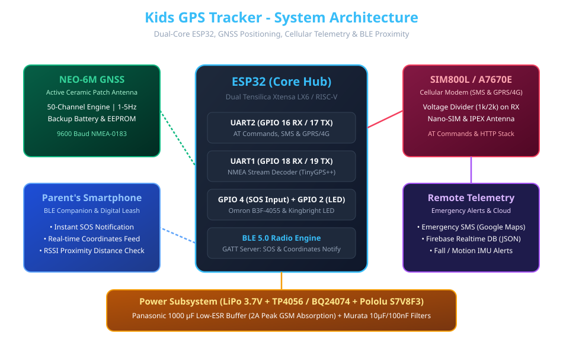
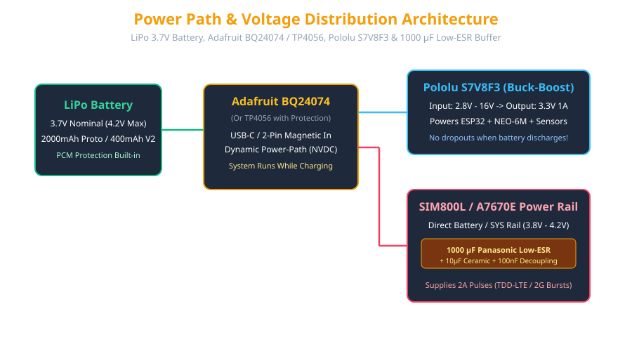

# 🛰️ Kids GPS Tracker (ESP32 + GSM/4G + GNSS)

An open-source, highly reliable, wearable safety tracker designed for children. This repository chronicles the complete engineering evolution of the device—from an initial breadboard prototype built with **ESP32 + SIM800L 2G + NEO-6M GPS** to a compact commercial target featuring **ESP32-C3 + SIMCom A7670E 4G LTE + Bluetooth LE Proximity**.

---

## 🗺️ Project Architecture & Version Roadmap

| Version | Folder | Core Focus & Features | Hardware Configuration |
|---------|--------|-----------------------|------------------------|
| **V0.0.1** | [`01_sms_basic/`](./01_sms_basic/) | Basic GSM communication & AT command parsing | ESP32 + SIM800L 2G + Level Shifter |
| **V0.0.2** | [`02_gps_serial/`](./02_gps_serial/) | GNSS NMEA sentence parsing via TinyGPS++ | ESP32 + NEO-6M GPS Module |
| **V0.0.3** | [`03_gps_sms_sos/`](./03_gps_sms_sos/) | SOS button trigger, Google Maps SMS & **BLE Companion** | ESP32 + SIM800L + NEO-6M + Omron Button |
| **V0.0.4** | [`04_gprs_firebase/`](./04_gprs_firebase/) | GPRS data logging & Real-time JSON Firebase upload | ESP32 + SIM800L + Firebase Realtime DB |
| **V0.0.5** | [`05_power_deepsleep/`](./05_power_deepsleep/) | Power management, modem CPOWD & ESP32 Deep Sleep | ESP32 + LiPo + Pololu S7V8F3 + Wakeup GPIO |

---

## 🔬 Hardware Components Rationale

A deep dive into why each component was meticulously selected for this project:

1. **ESP32 DevKit v1 / ESP32-C3 Super Mini**:
   - **Rationale:** Dual-core processing (or RISC-V on C3), multiple hardware UARTs (allowing concurrent communication with GPS and GSM without software serial bottlenecks), low cost, and integrated Wi-Fi / Bluetooth Low Energy (BLE 5.0).
2. **SIM800L (V1-V3 Prototyping) & SIMCom A7670E (V2 Production)**:
   - **Rationale:** SIM800L is the ultimate ultra-cheap 2G modem for prototyping AT command state machines and SMS workflows. For production, migrating to SIMCom A7670E ensures 4G LTE Cat.1 connectivity with backward compatibility (3G/2G) as legacy 2G networks sunset globally.
3. **NEO-6M GNSS Module**:
   - **Rationale:** Industry-standard 50-channel receiver with active ceramic patch antenna, backup EEPROM, and battery RTC backup for rapid Time-To-First-Fix (TTFF).
4. **TP4056 / Adafruit BQ24074 + 1000 µF Low-ESR Capacitor**:
   - **Rationale:** GSM transmission bursts demand up to **2A peak current**. Without a dedicated bulk capacitor (Panasonic 1000 µF Low-ESR) and power-path management, current spikes cause immediate brownout resets. The BQ24074 ensures dynamic power-path control (the device runs on external USB/battery power while simultaneously charging the LiPo cell).
5. **Resistor Voltage Divider (1kΩ / 2kΩ)**:
   - **Rationale:** ESP32 GPIO logic operates at 3.3V, whereas SIM800L UART RXD operates at 2.8V max. The voltage divider safely steps down 3.3V to ~2.2V, preventing modem input latch-up and long-term degradation.
6. **Mini MPU-6050 (6-Axis IMU) & Vibration Motor (Optional)**:
   - **Rationale:** Motion detection enables intelligent sleep modes (deep sleeping when stationary during school hours) and tactile feedback for SOS confirmation.

---

## 🔌 System Architecture & Circuit Schematics

### Overall System Architecture

### Power Distribution & Management

---

## 🚀 Future Optimization & V2 Commercial Roadmap

1. **Migration to 4G LTE (SIMCom A7670E)**: Eliminates 2G network dependency and supports HTTPS/MQTT natively.
2. **Custom PCB Design (FR-4, 40×20mm)**: Replacing breadboards and jumper wires with a professional surface-mount layout.
3. **Enclosure (3D Printed PETG)**: Compact ergonomic case with magnetic 2-pin charging connector and lanyard clip.
4. **Companion Mobile App**: Flutter/React Native application connecting via BLE for proximity alerts and Firebase for remote map tracking.

---

## 📜 License
Distributed under the **MIT License**. See `LICENSE` for more information.
